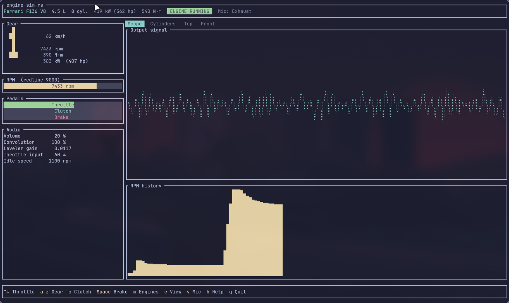
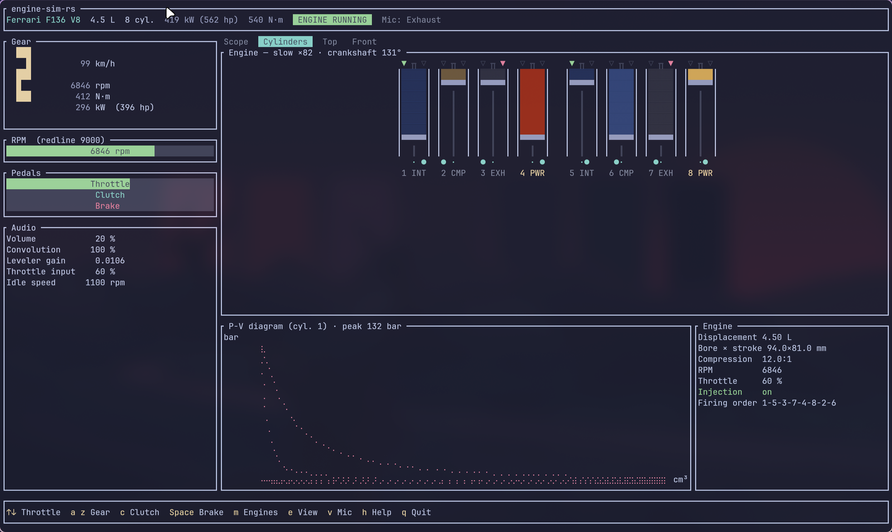
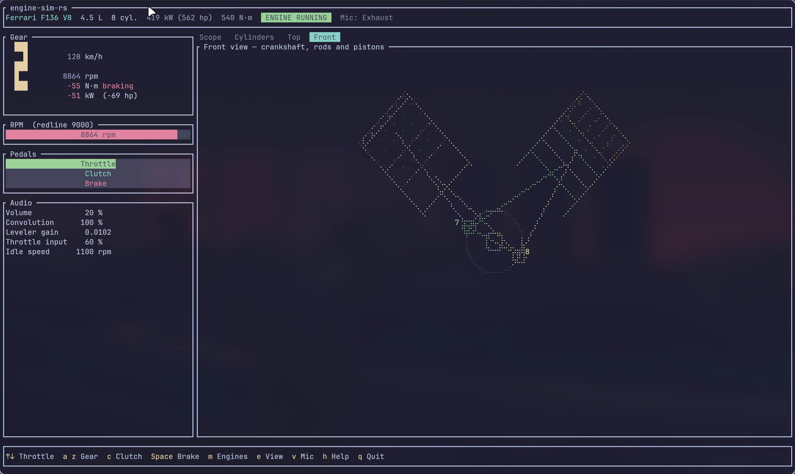
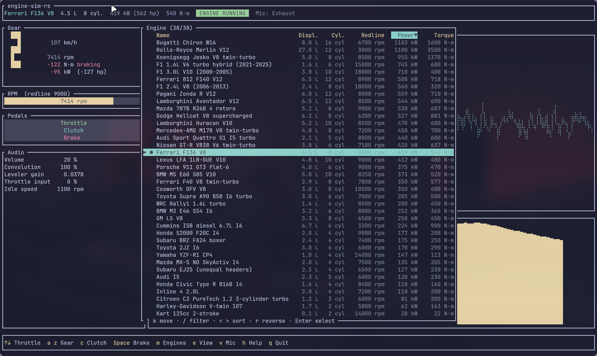
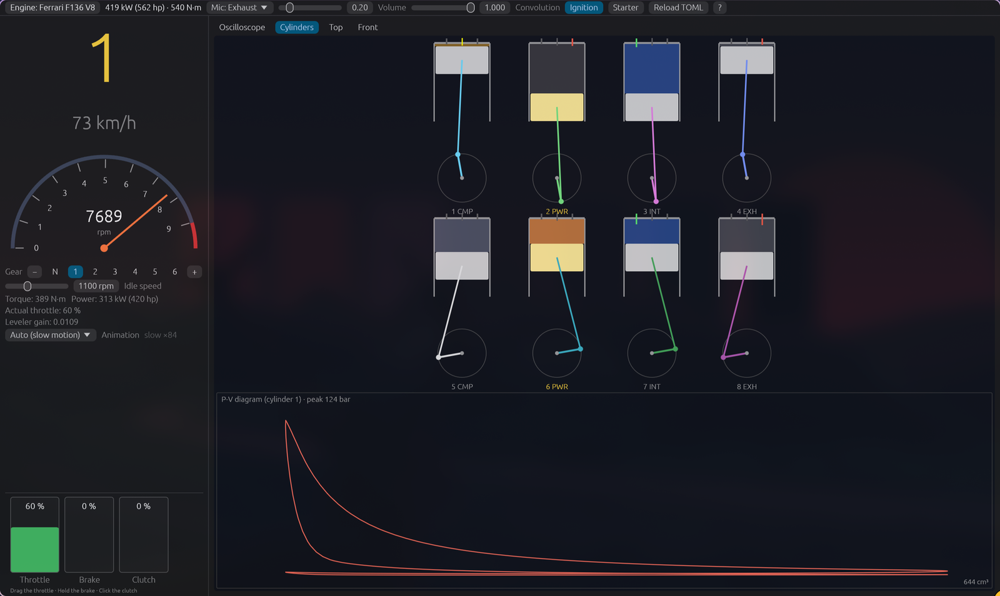
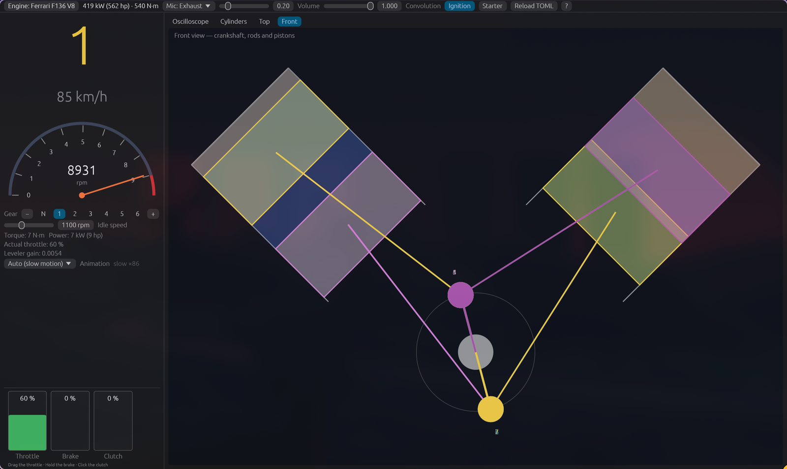
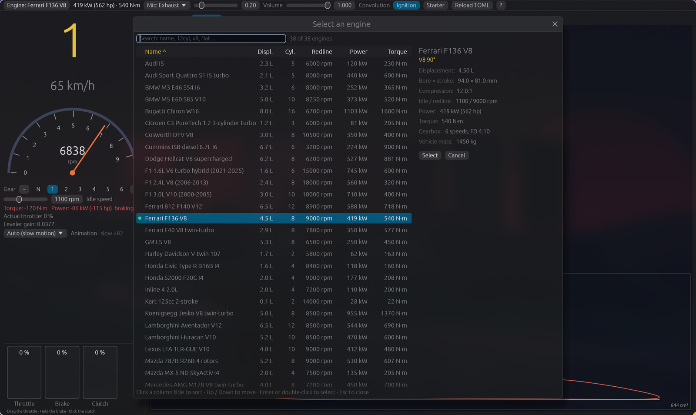

# engine-sim-rs

A simplified Rust version of [engine-sim](https://github.com/ange-yaghi/engine-sim)
(Ange Yaghi, MIT license, see `LICENSE-engine-sim`). The goal is **audio fidelity**;
the engine physics is deliberately reduced.

## Usage

```sh
cargo run --release                      # TUI, GM LS V8, real-time sound
cargo run --release -- --list
cargo run --release -- --engine ferrari_f136_v8
cargo run --release -- --wav out.wav --drive --seconds 40   # offline render with gearbox
```

## Screenshots

### Terminal interface (TUI)


*Live dashboard: gear, speed, rpm, torque and power, pedals, audio settings, output signal and rpm history.*


*Cylinders view: slow-motion pistons, valves, spark plugs and combustion, plus the P-V diagram of cylinder 1.*


*Front view: crankshaft, rods and pistons of both banks.*


*Engine list, sorted by power (click a column title or use `<` `>` and `r`).*

### Graphical interface (GUI)


*Cylinders in section, to scale, with the real crank-slider kinematics and the P-V diagram.*


*Front view of a V8: one colour per cylinder, the cylinder on its power stroke in yellow.*


*Engine picker: sortable table, search, and a detail pane (`M` or the "Engine" button).*

## Two interfaces

- **TUI** (default): `cargo run --release`.
- **GUI** (egui): `cargo run --release -- --gui`. Same controls (same keyboard, plus buttons and sliders),
  an engine picker window opened with `M` or the "Engine" button (sortable table of all engines, search, detail pane,
  Up / Down / Enter / Esc keys, double-click), vector-drawn cylinders, brake held while the space key or the button is held.
  `cargo build --no-default-features` builds the TUI only (without eframe).

Both share the simulation, the audio and the controls state (`src/pilot.rs`).

### TUI keyboard

Simple single-key shortcuts, as in btop (the bottom bar lists the main ones, `h` opens the full list):
`Up` / `Down` or `0`-`9` throttle (`f` full throttle, `x` throttle off), `a` / `Right` (shift up) and `z` / `Left` (shift down),
`n` neutral, `c` clutch, `Space` brake (toggle; adding throttle releases it), `s` starter, `i` ignition,
`[` `]` volume, `-` `=` convolution, `,` `.` idle speed (±50 rpm), `t` animation speed,
`e` / `E` next / previous view, `v` microphone, `r` reload the TOML files, `m` or `Tab` engine list, `h` / `?` / `F1` help, `q` quit.

Mouse (TUI): the wheel changes the throttle (over the Gear panel: shifts gears; over the Audio panel: volume,
convolution, idle speed); left / right click on Gear = shift up / down, middle click = neutral; gauges: throttle by
click or drag, clutch by click, brake while the button is held; left / right click on the right-hand view = next /
previous view; clicking the engine name or a key of the bottom bar (engines, view, mic, help, quit...) activates it;
in the list, wheel and click to select.

In the engine list (sorted alphabetically by default, like htop's process sorting): `<` `>` pick the sort column (name, displacement, cylinders, redline, power), `r` reverses the order, a click on a column title sorts by it (a second click reverses); `j` `k` (or `Up` `Down`) to move, `/` to start filtering (`Enter` confirms, `Esc` cancels; a single
match is selected directly), `Enter` selects, `Esc` closes. The help window (`h`) works the same way: `j` `k` to scroll,
`/` to filter. `/` from the main screen opens the engine list directly in filter mode.

Views (tabs above the right-hand panel, `e` key or a click on a tab): oscilloscope, animated cylinders (pistons, valves, spark plugs, combustion, P-V diagram of cylinder 1
from the simulation), top view (the cylinder on its power stroke highlighted, firing order) and front view
(crankshaft, rods and pistons of each bank). The microphone can be the exhaust, the cabin or the engine bay.
The GUI keeps its own keyboard (`?` for the list).

Ambience added after the synthesizer (`src/ambience.rs`): intake noise, turbo blow-off when the throttle closes,
transmission, tyre and wind noise, balanced according to the microphone. Offline: `--mic exhaust|cabin|bay` with `--wav`.

Engines: GM LS V8, Ferrari F136 V8, Ferrari 812 V12, Lamborghini Aventador V12, Bugatti Chiron W16 (4 turbos), Koenigsegg Jesko twin-turbo V8, Pagani Zonda R V12,
Lexus LFA V10, Lamborghini Huracán V10, Porsche 911 GT3 flat-6, Subaru BRZ boxer, Citroën C3 PureTech (3-cylinder
turbo), WRC Rally1 and Audi Quattro S1 (Group B, with anti-lag), Mazda 787B (4 rotors), Cosworth DFV, F1 V10,
Ferrari F40, Nissan GT-R, BMW M3 E46 and M5 V10, Mercedes-AMG M178, Dodge Hellcat (supercharged), Toyota Supra,
Honda S2000 and Civic Type R, Mazda MX-5, Harley V-twin, Cummins diesel, 2-stroke kart, Rolls-Royce Merlin,
F1 2.4 L V8 (18,000 rpm), Toyota 2JZ I6, Yamaha YZF-R1 (CP4, 14,000 rpm), F1 hybrid turbo V6 (1.6 L, 15,000 rpm,
MGU-K and turbine whine), Audi I5, Subaru EJ25 (unequal-length headers), 2.0 L inline-4. The engine changes live,
without quitting.

Gear changes are automated like a real manoeuvre: clutch out, shift, progressive clutch re-engagement (longer when
pulling away). Throttle and speed follow the real load (mass, drag, per-engine gear ratios).

## What is reproduced faithfully (`src/dsp.rs`, `src/synth.rs`)

The `Synthesizer` audio chain: linear resampling 10 kHz → 44.1 kHz, 4th-order Butterworth low-pass at 1900 Hz,
random jitter, DC filter (10 Hz), derivative (dF/F mix), air noise filtered at 2 kHz, convolution with the exhaust
impulse response (original WAV, 10,000 samples max), anti-aliasing at 0.45·fs, leveler, volume.
The exhaust flow is delayed according to the pipe length (speed of sound) and weighted by `1/L²`, as in
`PistonEngineSimulator::writeToSynthesizer`. Jitter, noise, HF gain and exhaust volumes come from the original
`.mr` scripts.

## What is simplified (`src/engine.rs`)

* Single-zone cylinder (ideal gas, Wiebe combustion, linear heat loss), runner → collector → atmosphere as
  lumped volumes, intake plenum, throttle. No constraint solver and no 1D gas dynamics: no dynamicPressure.
* Single-degree-of-freedom crankshaft, starter, idle governor, fuel cut on deceleration, rev limiter.
* Simple drivetrain: capped viscous clutch, fixed-ratio gearbox, vehicle (mass, drag, rolling resistance, brakes).
  No reverse gear and no dynamometer.
* A final soft clip (above 20,000) replaces the hard clip.
* One air-noise filter per channel (the original shares channel 0's).
* The `new/*.wav` responses of the original library are not in the repository: the engines concerned use the
  `archive/` responses (`real_engine_*`).
* Exhaust volumes were re-tuned so the leveler works in its range.

The engines are described in `src/presets.rs`.

## Fine tuning

`--set key=value` (offline render) lets you try settings without recompiling: `hf_gain`, `noise`, `jitter`,
`input_cutoff`, `air_noise_cutoff`, `dynamic_pressure_gain`, `pipe_volume_fraction`, `ir` (0-3),
`combustion_efficiency`, `burn_duration_deg`, `intake_boost`, `friction_scale`, `inertia`, `audio_volume`.
`--probe` measures the free-rev torque and power curve of the chosen engine, `--accel` its 0-100 / 0-200 / 0-300 km/h
times, and `--dump ID FILE` writes the raw source signal before synthesis.

## Tuning against a recording (F1 V8)

The F1 engine was tuned against the average spectrum of a recording of an F1 V8 at 8,400, 12,600 and 17,500 rpm
(see `--steady`, `--set`): firing order alternating between the banks, weaker right bank (the recording's
half-firing-frequency component), strong dynamic pressure, wide-open input filters, plus a light equaliser. The
average error per octave over these three speeds drops from about 13.5 dB to 4.5 dB. This only tunes the average
spectrum. Torque and power can be measured with `--probe`.

## Engines in TOML (no recompiling)

Every `.toml` file in `./engines/` and `~/.config/engine-sim-rs/engines/` (or given with
`--engines DIR_OR_FILE`, before `--list`) adds an engine to the list; a file with the same name as an existing
engine replaces it. In the TUI, `r` reloads the files and rebuilds the active engine.

- `base = "engine_id"` starts from an existing engine (see `--list`); only the fields you write change, tables
  (`[gearbox]`, `[turbo]`) are merged field by field, lists (`[[eq]]`, `[[exhausts]]`, `[[cylinders]]`) are replaced.
  `turbo = "none"` removes a turbo.
- `[firing]` generates the cylinders: `order`, `spacing`, `exhaust_map = "single" | "halves" | "alternate"`,
  `primary` or `primary_base` / `primary_step` / `primary_cycle`.
- `--dump-toml ID` prints the full description of an engine, to copy as a starting point.
- Unknown fields and absurd values are rejected with a message (a typo is an error, not a silent omission).

The engine list (and the GUI picker) shows each engine's nominal peak power and torque (`power_kw`, `torque_nm`, real-world figures for the car or engine; they can be set in TOML files and do not drive the simulation). The Gear panel (TUI) and the left panel (GUI) show the live engine torque (N·m) and power (kW / hp) at the crankshaft: gas torque + electric assist - friction, smoothed over ~0.15 s (negative on overrun, i.e. engine braking, shown in red with a "braking" tag). The values come from the simplified model, tuned to the real peak power of each engine, so treat them as indicative.

A commented example is in `engines/example_v8_rally.toml`.
